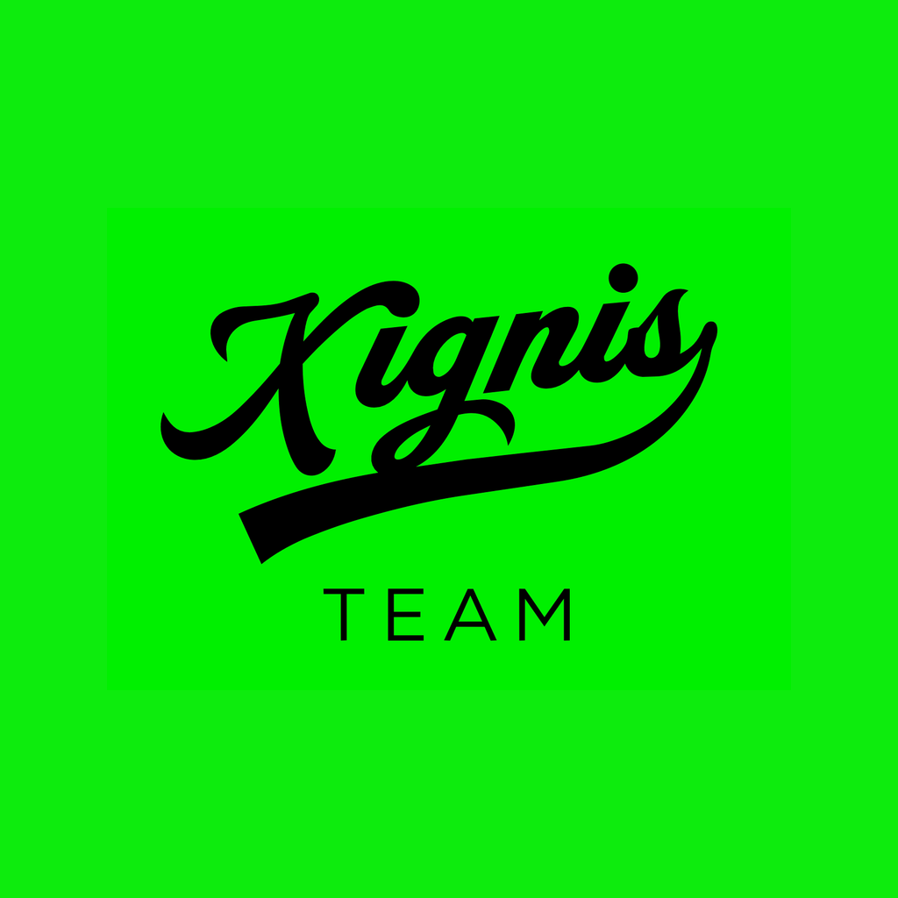

<div align="center">



# Xignis — Landing

### Página de presentación de Xignis, con fondo animado en WebGL y un título tipográfico interactivo


</div>

---

## 📋 Contenido

- [¿Qué es esto?](#-qué-es-esto)
- [Qué se ve en pantalla](#-qué-se-ve-en-pantalla)
- [Relación con el resto de Xignis](#-relación-con-el-resto-de-xignis)
- [Requisitos](#-requisitos)
- [Cómo ejecutarlo](#-cómo-ejecutarlo)
- [Scripts disponibles](#-scripts-disponibles)
- [Estructura del proyecto](#-estructura-del-proyecto)
- [El componente principal](#-el-componente-principal)
- [Identidad visual](#-identidad-visual)
- [Cómo cambiar el contenido](#-cómo-cambiar-el-contenido)
- [Publicación](#-publicación)
- [Limitaciones actuales](#-limitaciones-actuales)
- [Créditos](#-créditos)

---

## 🎯 ¿Qué es esto?

Es la **página web de presentación de Xignis**: un sitio de una sola pantalla que
muestra la marca mientras el producto sigue en desarrollo.

No tiene formularios, ni base de datos, ni cuentas de usuario. Es una página
estática: se compila a HTML, CSS y JavaScript, y se sube a cualquier hosting.

El paquete se llama `landing-xignis` en `package.json`.

> 💡 **¿Qué significa "landing"?**
> Una *landing page* es la primera página que ve alguien que llega al sitio.
> Aquí su única función es presentar la marca y avisar que el producto está
> por salir.

---

## 👀 Qué se ve en pantalla

La pantalla completa muestra, sobre fondo negro:

- ✅ El logotipo **Xignis** como wordmark 3D, con letras extruidas y biseladas
  que flotan y derivan ligeramente hacia el cursor.
- ✅ Un halo verde suave detrás del logotipo, que late muy despacio.
- ✅ La leyenda **Proximamente** en la parte inferior.

Todo el texto y los ajustes visuales están definidos en
[`src/App.jsx`](src/App.jsx).

---

## 🔗 Relación con el resto de Xignis

Xignis es un conjunto de repositorios separados. Este es el escaparate público;
los otros dos son aplicaciones internas con inicio de sesión:

| Repositorio | Qué es |
|---|---|
| **`xignis`** (este) | Landing pública de la marca. Sin backend. |
| [`xignis-app`](https://github.com/Leoglez10/xignis-app) | App de empleados y panel de RH (permisos y ausencias). |
| [`gestion-inventario-xignis`](https://github.com/Leoglez10/gestion-inventario-xignis) | Sistema de inventario y préstamo de equipo. |

Los tres comparten identidad visual (verde sobre negro), pero **no comparten
código ni dependen entre sí**. Este repositorio no enlaza actualmente a las
otras aplicaciones.

---

## ⚙️ Requisitos

- **Node.js** con soporte para ESM (el proyecto usa `"type": "module"`).
- **npm** — el repositorio incluye `package-lock.json`.
- Un navegador con **WebGL**, necesario para el fondo animado.

---

## 🚀 Cómo ejecutarlo

```bash
git clone https://github.com/Leoglez10/xignis.git
cd xignis
npm install
npm run dev
```

Vite imprime en la terminal la dirección local donde queda sirviendo el sitio.
No hay puerto fijado en la configuración: se usa el que Vite elija por defecto.

Para generar la versión de producción:

```bash
npm run build     # genera la carpeta dist/
npm run preview   # sirve dist/ para revisarlo antes de publicar
```

> 💡 No hay variables de entorno. El proyecto no necesita ningún archivo `.env`.

---

## 🧰 Scripts disponibles

| Script | Qué hace |
|---|---|
| `npm run dev` | Levanta el servidor de desarrollo con recarga en caliente. |
| `npm run build` | Compila el sitio a la carpeta `dist/`. |
| `npm run preview` | Sirve localmente lo que se generó en `dist/`. |

No hay scripts de test, lint ni typecheck: el proyecto no tiene esas
herramientas configuradas.

---

## 🗺 Estructura del proyecto

```text
xignis/
├── index.html                    ← Documento raíz; carga la fuente Space Grotesk
├── vite.config.js                ← Configuración de Vite (solo el plugin de React)
├── package.json
├── icon.png                      ← Copia del icono en la raíz
├── public/
│   ├── icon.png                  ← Favicon servido en /icon.png
│   └── xignis-wordmark-mask.png  ← Máscara del wordmark que se extruye en 3D
├── scripts/
│   └── build-logo-mask.py        ← Regenera esa máscara a partir de icon.png
└── src/
    ├── main.jsx                  ← Punto de entrada; monta React en #root
    ├── App.jsx                   ← ⭐ Contenido y ajustes visuales de la página
    ├── index.css                 ← Variables de color y reset global
    └── components/
        ├── Logo3D.jsx            ← Wordmark 3D flotante (Three.js)
        ├── LightRays.jsx         ← Sin usar. Fondo de haces de luz con OGL
        ├── LightRays.css
        └── TextPressure.jsx      ← Sin usar. Título tipográfico interactivo
```

> 💡 **Regla rápida**
> - Texto y colores de la página → `src/App.jsx`
> - Wordmark 3D, materiales y animación → `src/components/Logo3D.jsx`
> - Forma de las letras 3D → `public/xignis-wordmark-mask.png`, regenerable con
>   `python3 scripts/build-logo-mask.py`
> - Colores globales y tipografía → `src/index.css` e `index.html`

---

## 🧩 El componente principal

### `Logo3D.jsx` — wordmark 3D flotante

Es lo que sustituye a la animación anterior. Dibuja el logotipo con **Three.js**.

**Cómo funciona.** Las letras no son texto 3D: el logotipo se convierte en un mapa
de alturas. El script [`scripts/build-logo-mask.py`](scripts/build-logo-mask.py)
recorta el wordmark de `public/icon.png` y guarda una máscara en escala de grises
(blanco = letra, negro = fondo) en `public/xignis-wordmark-mask.png`. Esa máscara
se desplaza sobre un plano subdividido denso, así que cada letra es geometría
real con bisel redondeado, no un sprite plano.

Dos detalles que importan si se toca el archivo:

- La máscara se usa **además como recorte** (`alphaMap`). Sin eso, el espacio
  entre letras seguiría sombreando como metal y el logo se vería como un rectángulo
  verde sólido en lugar de letras sueltas.
- El sombreado usa **normales por fragmento** calculadas a partir de la máscara,
  no las normales del vértice. Un trazo mide unas diez celdas de malla, así que con
  normales de vértice el bisel se ve facetado, especialmente en el punto de la `i`.

Acepta props para controlar el resultado. Los valores que usa la página están en
`src/App.jsx`:

| Prop | Valor en la página | Para qué sirve |
|---|---|---|
| `color` | `#08EF01` | Color del metal y de la luz de contra. |
| `glowColor` | `#08EF01` | Color del halo de fondo. |
| `glow` | `true` | Enciende o apaga el halo. |
| `depth` | `0.42` | Profundidad de la extrusión. |
| `floatIntensity` | `1` | Amplitud del flotado y del latido del halo. `0` lo deja quieto. |
| `parallax` | `0.22` | Cuánto gira el logo siguiendo el cursor. |
| `metalness` | `0.72` | Material del logo. |
| `roughness` | `0.24` | Material del logo. |
| `background` | `#020401` | Color de fondo del canvas. |

La animación es deliberadamente leve: un flotado vertical, una rotación lenta en
los tres ejes y un paralaje amortiguado hacia el puntero. Con
`prefers-reduced-motion: reduce` el flotado se desactiva y el paralaje se queda
en cero.

### Componentes sin uso

`LightRays.jsx`, `LightRays.css` y `TextPressure.jsx` ya no se importan. Se
mantienen en el repositorio, pero nada los carga; ver
[Limitaciones actuales](#️-limitaciones-actuales).

---

## 🎨 Identidad visual

Definida en [`src/index.css`](src/index.css) e [`index.html`](index.html):

| Elemento | Valor |
|---|---|
| Verde de marca | `#08EF01` (variable CSS `--green`) |
| Fondo | `#020401` (variable CSS `--black`) |
| Tipografía | Space Grotesk, cargada desde Google Fonts |
| Título de la pestaña | `Xignis` |
| Favicon | `/icon.png` |

> ⚠️ La fuente se descarga desde `fonts.googleapis.com`. Sin conexión a
> internet, el navegador usa la tipografía de respaldo del sistema.

---

## ✏️ Cómo cambiar el contenido

| Quiero cambiar… | Archivo | Dónde |
|---|---|---|
| El texto "Proximamente" | `src/App.jsx` | Dentro de `<p style={styles.tagline}>` |
| El color verde | `src/index.css` y `src/App.jsx` | `--green` y las props `color` / `glowColor` |
| La profundidad de las letras | `src/App.jsx` | Prop `depth` de `<Logo3D>` |
| La intensidad del flotado | `src/App.jsx` | Prop `floatIntensity` de `<Logo3D>` |
| La reacción al cursor | `src/App.jsx` | Prop `parallax` de `<Logo3D>` |
| El material del logo | `src/App.jsx` | Props `metalness` y `roughness` de `<Logo3D>` |
| La forma de las letras | `public/xignis-wordmark-mask.png` | Regenerar con `python3 scripts/build-logo-mask.py` |
| El título de la pestaña o la descripción | `index.html` | `<title>` y `<meta name="description">` |
| El favicon | `public/icon.png` | Reemplazar el archivo |

---

## 📤 Publicación

`npm run build` deja el sitio listo en `dist/`. Al ser una página estática de una
sola ruta, se puede servir desde cualquier hosting de archivos estáticos sin
configuración adicional de rutas.

> ⚠️ El repositorio **no incluye** workflows de GitHub Actions ni ningún otro
> mecanismo de despliegue automático. La publicación es manual.

---

## ⚠️ Limitaciones actuales

- Es una página de una sola pantalla: no hay navegación, rutas ni secciones adicionales.
- No hay formulario de contacto ni captura de correos.
- No hay tests, linter ni comprobación de tipos configurados.
- No hay integración continua ni despliegue automático.
- El wordmark depende de WebGL; en un navegador sin soporte no se dibuja, aunque
  el resto de la página (leyenda incluida) sigue visible.
- Three.js pesa: el bundle sube a unos 168 kB comprimidos y Vite avisa por superar
  el umbral de 500 kB sin comprimir. No hay code splitting.
- La máscara del wordmark es un archivo generado y versionado. Si cambia
  `public/icon.png`, hay que volver a ejecutar `scripts/build-logo-mask.py`;
  si no, el 3D sigue mostrando la forma antigua.
- `LightRays.jsx`, `LightRays.css` y `TextPressure.jsx` no se usan, y con ellos la
  dependencia `ogl` sigue instalada pero sin ningún import que la necesite.
- El repositorio no incluye archivo `LICENSE`, por lo que **no tiene una licencia pública declarada**.
- El texto "Proximamente" aparece sin tilde en el código actual.

---

## 👤 Créditos

<div align="center">

Diseñado y desarrollado por **Leonardo González**

[](https://github.com/Leoglez10)

</div>
